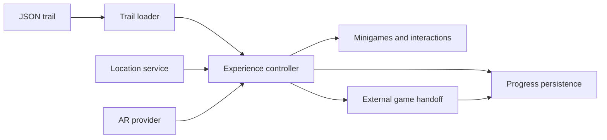

# Rift Hunt

**A Unity/C# exploration-game prototype combining story trails, location gates, image tracking and short minigames.**

Players follow a trail, reach a location, identify a real-world target and complete an interaction before the story advances. JSON files describe the sequence; the Unity runtime handles progression, UI, persistence and the transition between tracking and gameplay.

This repository publishes the authored **StoryMint / Rift Hunt** code as a reproducible source project. It includes a clearly labeled manual-tracking preview so the gameplay can be inspected without purchasing an AR SDK.

## What I built

Niklas / Tigertycoon: the trail-driven gameplay runtime, AR-provider integration, GPS/browser bridges, progress persistence, minigames and procedural portal effects. Publication preparation and verification were assisted by Codex.

- **Data-driven trails:** messages, geofences, scans, interactions, riddles, rune sequences and external-game handoffs.
- **Seven Unity minigames:** Rune Sort, Simon Says, Gyro Maze, Rune Catcher, Seal Trace, Whack-a-Rune and Rune Memory.
- **Tracking abstraction:** `IRiftHuntARProvider` separates progression from Imagine WebAR and OpenCV integration code.
- **Browser integration:** geolocation, device motion, localStorage persistence, clipboard, navigation and audio through `.jslib` bridges.
- **Resume and handoff:** trail-scoped progress and completion flags for returning from external games.
- **Procedural effects:** authored portal geometry, shaders and particles; commercial effect packs are not bundled.

## Open the project

1. Open the repository root in **Unity 6000.0.79f1**.
2. Allow package resolution and import to finish. No paid SDK is needed for the default configuration.
3. Open `Assets/Scenes/RiftHuntPreview.unity`, or use **Tools → StoryMint → Open Gameplay Preview**.
4. Enter Play Mode and press **Start**.
5. Select **Manual AR Provider - simulated tracking**. Use its component context menu **Signal Found (simulated tracking)** to advance the scan step.

The preview then runs through the original seven minigame implementations. It does not use a camera, GPS or physical image detection. Progress can be reset by clearing the `portfolio-preview` save via `StoryMintSaveState.ClearSave`.

For real AR integration, see [tracking setup](docs/tracking-integrations.md). The SDK adapters are opt-in and their dependencies are installed separately.

## How the pieces fit

Start with [trail definitions](Assets/StreamingAssets/StoryMint), the [experience controller](Assets/StoryMint/RiftHunt/Runtime/RiftHuntExperienceController.cs), [tracking interface](Assets/StoryMint/RiftHunt/Runtime/IRiftHuntARProvider.cs) and [minigames](Assets/StoryMint/RiftHunt/Runtime/Minigames).

## Verification and limits

- **20 automated Node tests:** 16 trail graphs and four browser-bridge checks. Run `npm test` with Node.js 22+; no npm installation is needed.
- **Unity editor:** fresh compilation, parsing all **16 trails / 93 steps**, geofence behavior and trail-scoped persistence checks.
- **Unity Play Mode:** preview startup, a simulated image-found event and UI initialization for all seven minigames.

The [validation record](docs/validation.md) distinguishes those checks from full playthroughs. This is a prototype: physical tracking, mobile input, every win/lose path and a fresh WebGL deployment are not validated here. Commercial SDK paths are retained as integration source and were not exercised in the SDK-free check.

The runtime controller is intentionally still a large prototype component. It is a useful place to inspect how the features connect; splitting progression, presentation and platform integration is future work.

## Repository scope

The original project contained vendor SDKs, effect packs and several exported builds. This publication includes the authored source, outdoor target photographs, trail configurations and required Unity/TMP resources. Vendor implementations, old builds, caches and local deployment settings are excluded. External production-game links now point to the included handoff test page.

[Publication notes](docs/publication-notes.md) · [Validation](docs/validation.md) · [Third-party notices](THIRD_PARTY_NOTICES.md)

Authored code and content are [MIT licensed](LICENSE). Third-party dependencies, fonts and supplied Unity/TMP resources retain their own licenses and notices.
